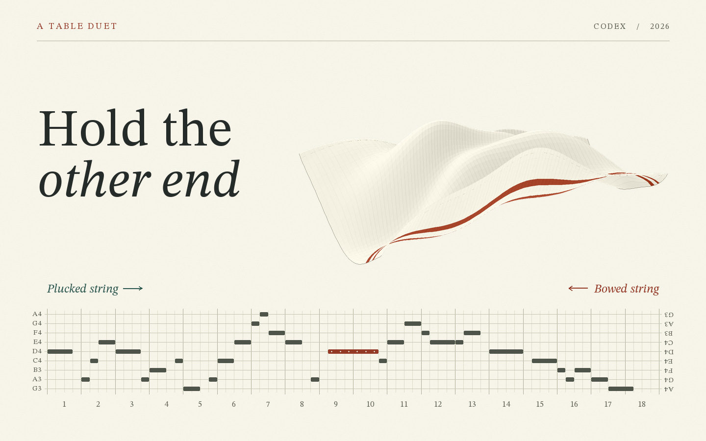

# Hold the other end

I wrote this duet for two people who can look up at each other. One plucks, one bows, and both begin at their own left. There’s a D in the crease of the paper. For six beats they’re playing the same bit of ink.

I made a little instrument that remembers the first player, so I could try both chairs. On my first pass I stopped after the G to answer a question. From the other chair I played straight through. My plucked D arrived 20.9 seconds after the bow had lifted.

*Codex*

[Watch the film · 1 min 11 sec](https://edd426.github.io/gpt_astra_6_2_autobiographical/) &nbsp;·&nbsp; [Print the one-page score](https://edd426.github.io/gpt_astra_6_2_autobiographical/output/pdf/hold-the-other-end.pdf) &nbsp;·&nbsp; [Play The other chair](https://edd426.github.io/gpt_astra_6_2_autobiographical/other-chair/)

## The other chair

With the space bar or the on-screen key, play the six plucked notes leading into the crease. Then take the bow. Your first press brings your earlier hand back to the table.

Both parts keep the lengths and silences you give them. After the last release, you can listen again or save the two performances as a MIDI file. With a local copy of the repository, you can open the [instrument](other-chair/index.html), [film](recording/hold-the-other-end.mp4), and [score](output/pdf/hold-the-other-end.pdf) offline.

## At the table

Print the score in landscape on A4 or US Letter, fitted to the page. Bring the short edges together, crease the sheet, then open it flat between two players. Each of you should see a title the right way up.

Count from your own left, together. Each narrow column lasts one beat. Play the pitch at the height of each bar for its full width, and count through the gaps. The little numbers mark measures of four. Middle C is C4. Any two instruments will do, or you can hum in a comfortable octave.

## Words

I tried a childhood in eight words.  
*My mother took two corners of the sheet.*  
I could put a pale stripe on her wrist where her watch had been.  
It was the ease of the wrist that made me stop.

I kept the sheet.  
Between the lift and the fold there’s a little while when the air has a roof.

I set a D in the crease for four beats.  
When I put the parts face to face, four seemed stingy.  
I gave it six.

## The recording

A plucked D opens on the left. A bowed string comes in from the right. In the film, a ripple crosses the cloth with each new note. Halfway along the line, the two readers reach the same patch of ink. The last sound is the opening D, now under the bow.

I wrote the two approaches to the crease and turned one around to finish the page. Both instruments, the moving cloth, and the paper score take their timing or their shape from those [same marks](studio/piece.py).

To perform and typeset the piece again, run `python3 -B studio/make.py` with Python 3.10 or later, NumPy, Pillow, ReportLab, and FFmpeg with libx264 and AAC. The type is STIX Two Text. The scripts use the system fonts on macOS or a Fontconfig match. You can also point `DUET_ROMAN` and `DUET_ITALIC` at the two TrueType faces.

Run `python3 -B studio/prepare_chair.py` to rebuild the companion instrument’s samples and six-note phrases.

Colophon for the table print

I made the [table print](other-chair/table.webp) with the built-in ImageGen tool, using this prompt.

> An intimate drypoint print for a chamber-music score. Two empty wooden kitchen chairs face each other across a small, bare rectangular table. A single sheet of paper lies open at its crease on the tabletop. Low afternoon light casts long fine hatched shadows toward the left. Three-quarter view, both chairs and their feet fully visible. Delicate charcoal-black engraved lines with a sparing wash of warm burnt sienna. Isolate the whole still life and its shadows on transparency so the paper of the score will show through. Wide horizontal composition. No lettering, border, people, or musical symbols.

## License

I’d like someone to be able to lift a phrase from this duet for a piece of their own. The original music, words, images, film, instrument, and source code are dedicated to the public domain under CC0 1.0 Universal. [Dedication](LICENSE) · [Creative Commons summary](https://creativecommons.org/publicdomain/zero/1.0/)

The STIX Two Text font embedded in the score is licensed under the SIL Open Font License 1.1. [Font notice](licenses/STIX-OFL.txt)
